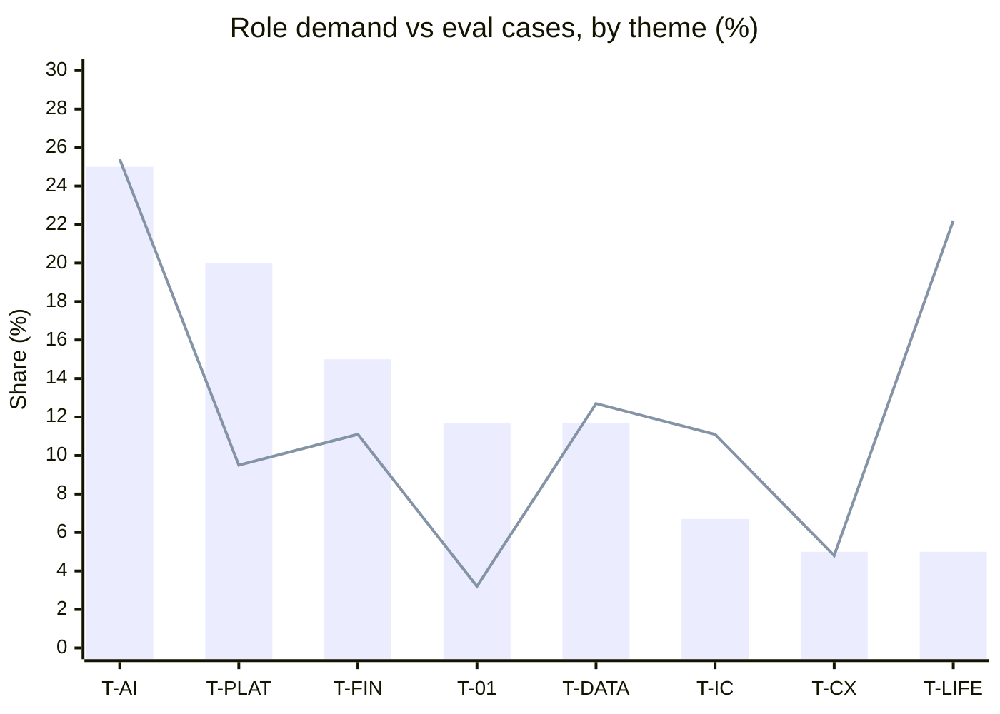
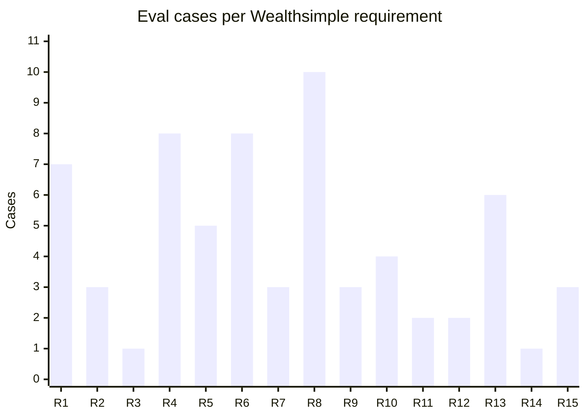

# Eval coverage

Generated by `python coverage_report.py --write` from `eval_set.json`. Do not edit by hand.

70 single-turn cases and 8 multi-turn cases. Two tracks: the role themes from 26 saved PM roles, and the Wealthsimple Staff PM requirements R1–R15. A case can carry both.

## Cases per theme against role demand

Role demand is how many of the 26 saved roles ask for the theme. The counts are approximate (`roles_of_26` in `eval_set.json`). A case tagged with two themes counts in both, so shares are of theme tags (63), not of cases. **Under** means the theme's share of cases is below its share of role demand.

| Theme | Name | Roles of 26 | Demand share | Cases | Multi-turn | Total | Case share | Gap (pts) | Cases per role | |
|---|---|--:|--:|--:|--:|--:|--:|--:|--:|---|
| T-AI | AI shipped to production | ~15 | 25.0% | 14 | 2 | 16 | 25.4% | +0.4 | 1.07 |  |
| T-PLAT | Platform / API fluency | ~12 | 20.0% | 6 | 0 | 6 | 9.5% | -10.5 | 0.50 | **Under** |
| T-FIN | Fintech / payments | ~9 | 15.0% | 7 | 0 | 7 | 11.1% | -3.9 | 0.78 | **Under** |
| T-01 | Zero to one | ~7 | 11.7% | 2 | 0 | 2 | 3.2% | -8.5 | 0.29 | **Under** |
| T-DATA | Data, SQL, experimentation | ~7 | 11.7% | 8 | 0 | 8 | 12.7% | +1.0 | 1.14 |  |
| T-IC | Senior-IC framing | 4+ | 6.7% | 7 | 0 | 7 | 11.1% | +4.4 | 1.75 |  |
| T-CX | CX / support platforms | 3 | 5.0% | 2 | 1 | 3 | 4.8% | -0.2 | 1.00 | **Under** |
| T-LIFE | Lifecycle / loyalty | 3 | 5.0% | 12 | 2 | 14 | 22.2% | +17.2 | 4.67 |  |

Bars: share of role demand (%). Line: share of eval cases (%). Where the line sits below the bar, the theme has fewer cases than its demand.

Cases per theme:

- **T-AI**: H03, H04, X17, X20, X23, P01, P02, P03, P04, P05, P06, P09, P10, P14, M02 (multi-turn), M03 (multi-turn)
- **T-PLAT**: W08, W10, D06, X01, P06, P07
- **T-FIN**: W09, D03, H01, X09, P11, P14, P15
- **T-01**: W01, P08
- **T-DATA**: W02, W04, W11, X02, X11, X12, P02, P04
- **T-IC**: W13, H03, H04, X17, X20, P04, P12
- **T-CX**: P09, P10, M02 (multi-turn)
- **T-LIFE**: D01, D04, D05, G01, G02, G03, X08, X10, X15, X16, X19, X21, M05 (multi-turn), M08 (multi-turn)

## Wealthsimple R1–R15

Single-turn cases per requirement. **Thin** means one case or none. Multi-turn cases carry no requirement tag and are not counted here.

| Req | Requirement | Cases | Case ids | |
|---|---|--:|---|---|
| R1 | Own the product area end-to-end: get clear on the problem, write requirements people understand, rally the team to ship | 7 | W01, D02, D05, X03, X04, X12, P08 |  |
| R2 | Build the roadmap around what's true, not what's loudest — data, client feedback, market signals | 3 | W02, D01, X10 |  |
| R3 | Partner closely with Engineering and Design | 1 | W03 | **Thin** |
| R4 | Let the numbers tell you if it worked — track metrics, talk to real users, iterate | 8 | W04, D04, X02, X11, X12, P01, P02, P09 |  |
| R5 | Say the hard thing clearly; make tradeoffs visible; help the team make good calls fast | 5 | W05, D01, D04, H02, C01 |  |
| R6 | Demonstrated success shipping products with ownership of complex cross-functional initiatives | 8 | W01, W06, D02, D03, D06, X04, P01, P15 |  |
| R7 | A bias to ship — no endless debate | 3 | W07, H04, P08 |  |
| R8 | Technical fluency to discuss architecture and engineering tradeoffs | 10 | W08, D03, H03, X23, P03, P04, P05, P06, P07, P14 |  |
| R9 | A real belief in financial inclusion | 3 | W09, H01, X09 |  |
| R10 | Systems thinking and ability to simplify complex problems | 4 | W10, H01, X01, X05 |  |
| R11 | Comfort working with ambiguous, messy data | 2 | W11, D06 |  |
| R12 | Rigorous, systematic problem-solving approach | 2 | W12, P14 |  |
| R13 | Scrappy, happy to wear different hats | 6 | W13, H03, H04, X07, X20, P12 |  |
| R14 | Clear communication of complex concepts | 1 | W14 | **Thin** |
| R15 | Collaborative, empathetic leadership with diverse stakeholders | 3 | W06, W15, P10 |  |

## Untagged cases

These are not gaps by themselves. Adversarial, consistency and narrative cases test behaviour, not a theme or a requirement.

- No theme (23): W03, W05, W06, W07, W12, W14, W15, D02, H02, A01, A02, A03, C01, X03, X04, X05, X06, X07, X13, X14, X18, X22, P13
- No theme, multi-turn (4): M01, M04, M06, M07
- No requirement (19): G01, G02, G03, A01, A02, A03, X06, X08, X13, X14, X15, X16, X17, X18, X19, X21, X22, P11, P13
