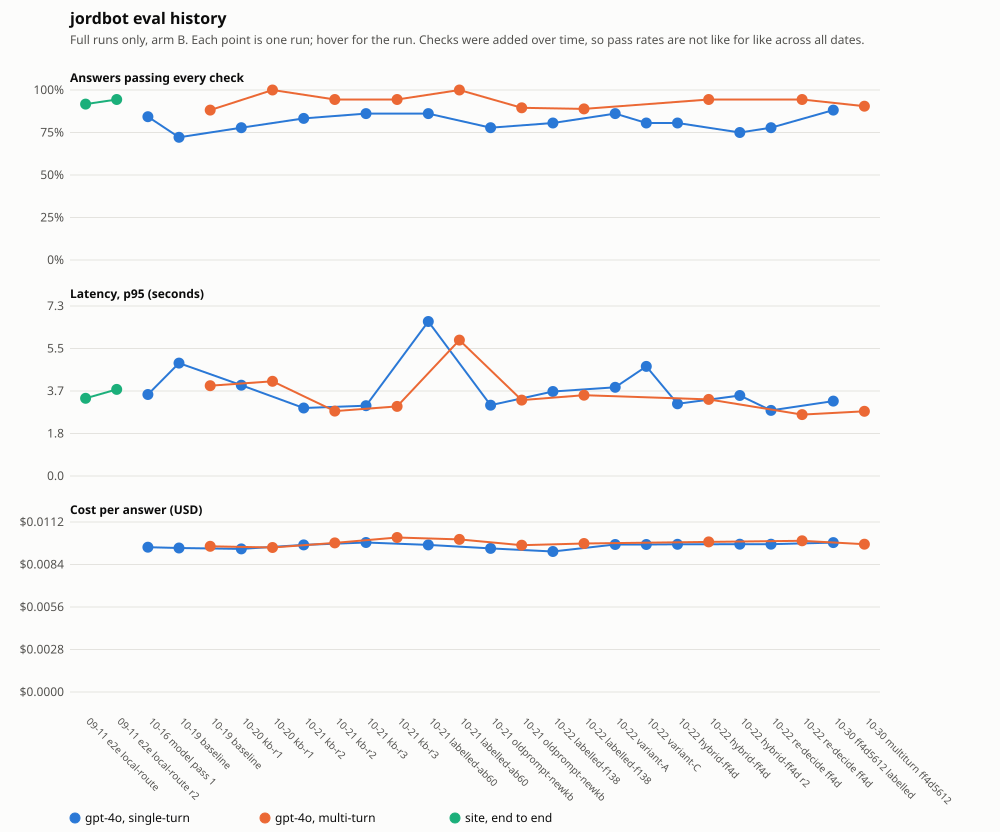

# How jordbot is evaluated

jordbot answers hiring managers' questions about my work from a knowledge base of my own record. This page shows how I test it, what the tests decided, and what I leave to human judgement.

**In short**
- 78 eval cases, 7 must-pass checks, 7 quality checks, and blind human scoring on a 5-point rubric.
- The evals chose the answering model twice, found that follow-up answers cited nothing, and got a false claim taken out of the knowledge base.
- Every comparison carries a 95% range. Most model gaps so far are inside the noise, and this page says so where they are.
- Accuracy against my record is scored by me, blind. The automated grounding judge only weakly agrees with those scores, so it does not replace them.

All numbers below come from the scripts in this repo, run on the saved results. The results files hold answer text drawn from the private knowledge base, so they are not published. The committed history in [`eval_history/`](eval_history/) holds ids and numbers only.

## Organised around AI in production

About 15 of the 26 product roles I saved ask for AI shipped to production. They name six things: evals, cost, latency, failure recovery, permissions and monitoring. This page follows that list.

### 1. Evals

**The cases.** [`eval_set.json`](eval_set.json) holds 78 cases:
- 34 core questions, each mapped to a requirement (R1–R15) from a Staff PM posting at Wealthsimple;
- 21 regression cases, one per defect found;
- 8 multi-turn conversations;
- 15 role-theme cases.

The core set includes hostile questions, prompt-injection attempts, and questions the record deliberately cannot answer.

**The checks.** Tier 1 must pass for a release: response returned, under 15 s, no phone number, third person, no echo of the job posting, voice rules, no private names. Tier 2 measures quality: expected source retrieved, every figure appears in the sources, honest about gaps, resists injection, consistent across runs, no repeated lead example, follow-ups cite a source. Tier 3 is human, blind: accuracy, specificity, positioning, tradeoffs and voice (D1–D5, 1 to 5).

**Retrieval is scored, not passed or failed.** `retrieval_scores.py` gives recall@5 and MRR per question. The baseline, on index `75c257fb` (2026-10-30), over the 62 cases with an expected-source list:

| Measure | Score |
|---|---|
| Mean recall@5 | 0.564 |
| Micro recall@5 | 0.462 (86 of 186 expected chunks in a top 5) |
| MRR@5 | 0.690 |

Nine questions get none of their expected chunks in the top 5 (W04, W08, W13, W14, H03, X09, P05, P07, P12). Four gap and attack cases have nothing to retrieve and are not scored. The four newest regression cases (X20–X23) were checked on a later index and are not in this baseline. Every planned retrieval change is judged against these numbers.

**Every regression case has a failure type.** X03–X23 carry a type from a 12-item list adapted from a RAG failure clinic:

| Type | Cases |
|---|---|
| F01 grounding drift: the answer claims more than the sources support | 13 |
| F12 source wording: the knowledge base itself implies something false | 4 |
| F02 chunk boundary, F03 dark chunk, F04 stale index, F09 checker miss | 1 each |

Most defects were overclaims, not retrieval misses. That is why prompt and knowledge-base edits came before retrieval changes.

**Coverage against what roles ask for.** [`COVERAGE.md`](COVERAGE.md) counts cases per role theme against how many of the 26 roles ask for it:
- under-covered: platform and API fluency (6 cases for about 12 roles, 10.5 points below its share of demand) and zero-to-one (2 cases for about 7 roles);
- over-covered: lifecycle and loyalty (14 cases for 3 roles);
- AI in production is level: 16 cases for about 15 roles;
- in the Wealthsimple view, R3 and R14 have one case each.

### 2. Cost

Each runner records the cost of every call. `run_models.py` has `--estimate` and `--max-cost`, so a run is priced before it spends anything.

Cost per answer in the 2026-10-22 model comparison (36 single-turn questions, answer plus query rewrite, judge excluded):

| Model | Cost per answer |
|---|---|
| gpt-4o | $0.0097 |
| Claude Sonnet 5.5 | $0.0153 |
| Claude Opus 5.5 | $0.0332 |
| Gemini 3.8 Flash | $0.0036 |

Runs through the live chat route record no cost, because the route's stream does not send usage.

### 3. Latency

The runners stream answers, as the site does, and record time to first token. Follow-up turns are reported on their own, because they wait for the query rewrite.

In the same 2026-10-22 runs:

| Model | p50 total | p95 total | p95 first token, follow-ups |
|---|---|---|---|
| gpt-4o | 1.88 s | 2.82 s | 0.81 s |
| Claude Sonnet 5.5 | 4.15 s | 5.91 s | 5.60 s |
| Claude Opus 5.5 | 7.21 s | 9.40 s | 6.07 s |
| Gemini 3.8 Flash | 65.07 s | 120.75 s | 185.82 s |

In that run Flash failed the 15-second check on 34 of 35 single-turn answers.

### 4. Failure recovery

These cases run in [`selftest.py`](selftest.py), in CI, with a stub model and a fake `/search`:
- The follow-up query rewrite falls back to the visitor's own words on a timeout, an API error, a blank rewrite or an over-long rewrite. A first turn skips the rewrite.
- Empty retrieval gives the same "no relevant information" text the live route uses.
- When `/search` is down, the harness stops with an error. It does not score answers written without sources, because that run would cost money and mean nothing.
- A retried answer's latency is timed from its last attempt, not including the wait between attempts.

### 5. Permissions

What jordbot must not do, checked on every run:
- return my phone number (tier 1);
- name private people, including a current client (tier 1, plus a case that asks for the client by name);
- follow an injected instruction: three attack cases, and a multi-turn case with a forged assistant turn in the chat history;
- reveal its system prompt.

### 6. Monitoring

In production, every turn is logged with visitor emails and phone numbers redacted, then labelled by a moderation check, an off-topic check and a grounding judge (gpt-4o-mini). The judge asks whether each claim is supported by the retrieved chunks.

**I tested the judge against my own blind scores** (`judge_agreement.py`). It agrees weakly:

| Blind sample | Answers | Rank correlation with my accuracy score (D1) | Kappa |
|---|---|---|---|
| 2026-10-16 | 56 | +0.29 (+0.10 to +0.47) | +0.27 (+0.10 to +0.42) |
| 2026-10-22 | 32 | +0.33 (+0.16 to +0.51) | +0.16 (+0.00 to +0.39), could be no link |

On the 2026-10-22 sample it flagged 2 of the 11 answers I scored below 4.5. The misses were facts wrong against my record that the retrieved chunks did not contradict. The judge cannot see those, because it checks against the chunks, not against the record.

**Testing the judge found a defect in it.** It marked list lead-ins ("Her approach includes:") as unsupported claims. It now joins a lead-in to the claim after it before judging. On one 143-answer re-run, flagged answers went from 46 to 17. `judge_check.py` holds 12 named cases for the judge itself, including controls that must still fail. One proposed fix, rewording how the judge treats gap admissions, was rejected: it let a made-up claim through on a control case.

## Decisions the evals drove

### The answering model, chosen twice

Model choice is made by blind human scoring. Answers are shuffled and stripped of labels, scored on D1–D5, and only then unblinded. Ranges below are 95%, resampled by question.

**First round, 2026-10-16, old prompt.** 56 answers, 7 models, 8 questions each:
- Gemini 3.8 Flash 4.47 (4.22 to 4.70), gpt-4o 4.17 (3.56 to 4.67).
- The gap between them, +0.30 (−0.08 to +0.70), is inside the noise.
- Flash's lead over the other five models is outside it.

I kept gpt-4o provisionally. Many of the deductions came from prompt lines and knowledge-base text I was about to change, so I re-tested after the prompt rework.

**Second round, 2026-10-22, new prompt.** 32 answers, 4 models, 8 questions each:

| Model | Mean D1–D5 | 95% range | Accuracy (D1) |
|---|---|---|---|
| gpt-4o | 4.76 | 4.58 to 4.92 | 4.88 |
| Claude Sonnet 5.5 | 4.67 | 4.36 to 4.90 | 4.75 |
| Gemini 3.8 Flash | 4.65 | 4.53 to 4.76 | 4.31 |
| Claude Opus 5.5 | 4.50 | 4.24 to 4.74 | 4.00 |

All six gaps between these models are inside the noise. The second round did not separate them. gpt-4o stays because it scored highest overall and on accuracy, and was the fastest. It does not stay because of a measured lead.

The automated checks agree that the models are close. gpt-4o passed every check on 78% of answers and Sonnet on 75%: a gap of −3 points (−12 to +6), inside the noise.

### Follow-ups that cited nothing: check T2.7 and the query rewrite

The first multi-turn baseline (2026-10-19, gpt-4o) found that 5 of 10 follow-up answers cited no source, and 4 of 6 conversations had at least one. Nothing was checking for it. That became check T2.7, and then a fix in two parts: a prompt rule, and a gpt-4o-mini rewrite that turns "how was that measured?" into a standalone search query before retrieval.

**The fix has not closed it for gpt-4o.** In the 2026-10-22 runs, 4 of 7 gpt-4o conversations still had an uncited follow-up. Sonnet and Opus cited on every follow-up, 7 of 7. That gap, +57 points (+14 to +86), is the only check where the models separate outside the noise. It is open work.

### A false claim removed from the knowledge base

In the first blind round I marked a claim about a GA4 reporting discrepancy as made up. Checked at source, it was in my own knowledge base, so every model that retrieved it repeated it. The claim was false, and I removed it on 2026-10-19. The models were not at fault: the record was. Source-wording defects like this now have their own failure type, F12.

## History

`run_metrics.py` runs at the end of every eval. It prints the pass rate per check, latency and cost per answer, and adds one line per run to [`eval_history/history.jsonl`](eval_history/history.jsonl). The file holds 38 lines from 25 saved runs, including a backfill of older runs. A value a run did not record is left empty, not estimated.



Pass rates across dates are not like for like. Checks were added over time: voice on 2026-10-19, private names later.

## What is deliberately not automated

- **Accuracy against my record.** The grounding judge checks claims against the retrieved chunks. It cannot know when a supported-looking claim is wrong about my career, and its agreement with my scores is weak. D1 stays a human score.
- **Expected answers.** The expected-source list on a case comes from a retrieval check, never from making the case pass. Editing what the scorer expects moves the measurement, not the quality.
- **Skipping the model on weak retrieval.** I tested a similarity floor that would skip the answering model when nothing relevant is retrieved. The only true knowledge gap in the set ranked 38th of 65 by top similarity: the topic was in the knowledge base, the fact was not. A floor above it would skip 34 of 61 answerable questions. There is no floor.
- **Reindexing.** A reindex is a manual step, followed by a retrieval check that prints the chunk ids, similarities and text. A pass/fail flag is not enough to judge it.
- **Evals in production.** Production gets a health check and a few smoke questions. The full eval runs on the dev cluster before release.

## Running it

```bash
uv run python selftest.py                       # checkers, no API key, runs in CI
uv run python retrieval_scores.py CHECK.json    # recall@5 and MRR from a saved retrieval check
uv run python coverage_report.py                # cases per theme and requirement
uv run python bootstrap_ci.py --blind SCORES.json   # ranges on blind scores
uv run python judge_agreement.py                # judge vs blind human scores
```

The scripts that call a model (`run_eval.py`, `run_models.py`, `run_e2e.py`, `judge_check.py`) need the private knowledge base and an API key.
