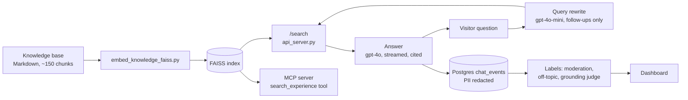

# jordannedyck-ai

[](https://github.com/jordanne-dyck/jordannedyck-ai/actions/workflows/ci.yml)

The retrieval backend and evaluation harness for **jordbot**, the chat assistant on [jordannedyck.com](https://jordannedyck.com). Hiring managers ask it about my work, and it answers from a knowledge base of my own record, citing the source of each claim.

I run it as a product, not a demo. Every change to the prompt, the index or the model goes through an eval set before it ships. Every answer in production is labelled for grounding, safety and cost.

This repo holds the Python side: the knowledge-base indexer, the `/search` API, an MCP server, and the eval harness. The chat interface, the production route and the monitoring dashboard are in [jordannedyck-ai-web](https://github.com/jordanne-dyck/jordannedyck-ai-web).

## How a question gets answered



1. **Index.** Each knowledge-base file is split on explicit chunk markers. Each chunk carries YAML metadata (id, priority, weight), gets a `[category] [title] [id]` prefix, and is embedded with `text-embedding-ada-002`. Chunks weighted below 0.3 are left out of the index.
2. **Rewrite.** On a follow-up turn, gpt-4o-mini turns "how was that measured?" into a standalone query. It has a 2.5-second budget. On a timeout, error or unusable output it falls back to the visitor's own words. A first turn skips the rewrite.
3. **Retrieve.** `/search` ranks the whole corpus two ways: by embedding similarity and by BM25 keyword match. The top 3 slots go to the embedding ranking. The rest are filled by reciprocal rank fusion of the two. It keeps at most 3 chunks per source file, and returns the top 5 with an `index_version` fingerprint. Any change in answer quality can then be traced to a specific reindex.
4. **Answer.** gpt-4o answers from those chunks only, cites chunk ids, and says plainly when the record does not cover something.
5. **Monitor.** Every turn is logged with visitor emails and phone numbers redacted. It is then labelled by a moderation check, an off-topic check, and a judge that asks whether each claim in the answer is supported by the retrieved chunks.

## Evaluation

The harness answers one question before anything ships: is this version better, and how do we know? **[EVALS.md](EVALS.md)** has the full account: results, ranges, the decisions the evals drove, and what is left to human judgement.

[`eval_set.json`](eval_set.json) holds 78 cases:

| Group | Cases | What they test |
|---|---|---|
| Core questions | 34 | The questions a hiring manager actually asks, each mapped to a requirement (R1–R15) from a real Staff PM posting at Wealthsimple |
| Regression cases | 21 | One per defect found in testing, each tagged with a failure type |
| Multi-turn conversations | 8 | Follow-ups, repeated examples, and a forged assistant turn (prompt injection through the chat history) |
| Role-theme cases | 15 | What 26 other PM postings ask for most: AI shipped to production, platforms and APIs, payments, zero to one |

There are 7 tier-1 checks, and a release needs all of them to pass. Tier 2 measures quality, including whether every figure appears in the sources and whether follow-ups cite one. Tier 3 is my own blind scoring on a five-part rubric. Retrieval is scored as recall@5 and MRR per question, and every comparison carries a 95% range, so a gap inside the noise is reported as noise.

What the evals decided, in brief:
- **The answering model, twice.** gpt-4o scored highest in the second blind round (4.76 of 5), but all gaps to Sonnet 5.5, Flash and Opus 5.5 were inside the noise. It stays on quality-first grounds, not on a measured lead.
- **Follow-ups that cited nothing** became check T2.7 and a query rewrite. The rewrite has not fully closed it for gpt-4o.
- **A false claim in the knowledge base** was found by blind scoring and removed.

The harness mirrors production: same prompt, same source layout. `run_e2e.py` checks the index and the prompt against the live route before its first paid call. `selftest.py` runs in CI and fails when this README's case counts, models, timeouts or ranking limits no longer match the code.

## Operating it

- **Safety.** The phone number is kept out of what the AI returns. Every eval run checks answers for private names, and runs the injection cases.
- **Cost.** `/search` caps query length and result count, because each query is a paid embedding call. Eval runners record the cost of every call.
- **Traceability.** `/health` reports chunk count, index size, the index fingerprint, the embedding model and whether the OpenAI key works. The indexer records its model next to the index; the server embeds questions with that model and refuses to start on an index whose vectors do not match it.
- **Deployment.** Containers are built in-cluster with Shipwright from a UBI9 multi-stage `Containerfile`. Argo CD deploys to OpenShift from git. The index lives on a persistent volume, not in the image.
- **Supply chain.** Dependencies are pinned in `uv.lock`. CI runs ruff, the selftest, and Trivy, with high and critical findings failing the build. GitHub Actions are pinned by commit.

## Tech stack

| Layer | Tools |
|---|---|
| Retrieval API | Python 3.11, Flask, FAISS, OpenAI embeddings |
| Chat and monitoring | Next.js, TypeScript, Vercel AI SDK, Postgres ([web repo](https://github.com/jordanne-dyck/jordannedyck-ai-web)) |
| Models | gpt-4o (answers), gpt-4o-mini (query rewrite, grounding judge); Claude and Gemini models in comparison runs |
| Agent access | MCP server exposing a `search_experience` tool |
| Infrastructure | OpenShift, Argo CD, Shipwright, GitHub Actions, Trivy, uv |

## Repository layout

```
api_server.py                 /search and /health
scripts/embed_knowledge_faiss.py   builds the FAISS index from the knowledge base
mcp_server/server_faiss.py    MCP server over the same index
EVALS.md                      how jordbot is evaluated, with results and decisions
eval_set.json                 eval cases, requirements and check definitions
coverage_report.py            cases per role theme and per requirement, writes COVERAGE.md
run_eval.py  run_e2e.py  run_models.py  citation_checks.py  selftest.py
run_metrics.py                headline metrics; writes eval_history/ (runs, retrieval scores, judge agreement; trend chart)
bootstrap_ci.py               confidence ranges on pass rates and blind scores; is a gap noise?
judge_agreement.py            does the grounding judge agree with the blind human scores?
analyse.py                    a run against the last comparable one: regressions, weakest checks, outliers
judge_check.py                named cases and re-judging for the grounding judge (judge_cases.json)
Containerfile  pyproject.toml  uv.lock
```

## Running it locally

The knowledge base is private and not in this repo. The code, eval set and harness are, and the selftest runs without it.

```bash
uv sync --frozen
uv run python selftest.py          # no API key needed
```

With a knowledge base in `knowledge-base/` and `OPENAI_API_KEY` in `.env`:

```bash
uv run python scripts/embed_knowledge_faiss.py   # build the index
uv run python api_server.py                      # http://localhost:5000
```

```
POST /search   { "query": "string", "n_results": 5 }
GET  /health
```

To use the MCP server with Claude, install `mcp` and add it to your Claude config:

```json
{
  "mcpServers": {
    "jordanne-resume": {
      "command": "python",
      "args": ["mcp_server/server_faiss.py"]
    }
  }
}
```
