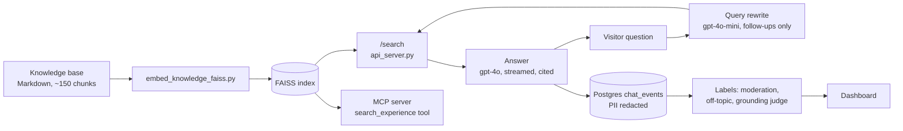

# jordannedyck-ai

[](https://github.com/jordanne-dyck/jordannedyck-ai/actions/workflows/ci.yml)

The retrieval backend and evaluation harness for **jordbot**, the chat assistant on [jordannedyck.com](https://jordannedyck.com). Hiring managers ask it about my work, and it answers from a knowledge base of my own record, citing the source of each claim.

I run it as a product, not a demo. Every change to the prompt, the index or the model goes through an eval set before it ships. Every answer in production is labelled for grounding, safety and cost.

This repo holds the Python side: the knowledge-base indexer, the `/search` API, an MCP server, and the eval harness. The chat interface, the production route and the monitoring dashboard are in [jordannedyck-ai-web](https://github.com/jordanne-dyck/jordannedyck-ai-web).

## How a question gets answered



1. **Index.** Each knowledge-base file is split on explicit chunk markers. Each chunk carries YAML metadata (id, priority, weight), gets a `[category] [title] [id]` prefix, and is embedded with `text-embedding-ada-002`. Chunks weighted below 0.3 are left out of the index.
2. **Rewrite.** On a follow-up turn, gpt-4o-mini turns "how was that measured?" into a standalone query. It has a 2.5-second budget. On a timeout, error or unusable output it falls back to the visitor's own words. A first turn skips the rewrite.
3. **Retrieve.** `/search` ranks the whole corpus by raw similarity, keeps at most 3 chunks per source file, and returns the top 5 with an `index_version` fingerprint. Any change in answer quality can then be traced to a specific reindex.
4. **Answer.** gpt-4o answers from those chunks only, cites chunk ids, and says plainly when the record does not cover something.
5. **Monitor.** Every turn is logged with visitor emails and phone numbers redacted. It is then labelled by a moderation check, an off-topic check, and a judge that asks whether each claim in the answer is supported by the retrieved chunks.

## Evaluation

The harness answers one question before anything ships: is this version better, and how do we know?

### The eval set

[`eval_set.json`](eval_set.json) holds 72 cases:

| Group | Cases | What they test |
|---|---|---|
| Core questions | 34 | The questions a hiring manager actually asks, each mapped to a requirement (R1–R15) from a real Staff PM posting at Wealthsimple |
| Regression cases | 16 | One per defect found in testing, each with a note saying what went wrong and what a correct answer looks like |
| Multi-turn conversations | 7 | Follow-ups, repeated examples, and a forged assistant turn (prompt injection through the chat history) |
| Role-theme cases | 15 | What 26 other PM postings ask for most: AI shipped to production, platforms and APIs, payments, zero to one. Two more extend the Wealthsimple track. Not scored yet |

Only the 34 core questions form the series that runs are compared on. The regression and role-theme cases are held outside it so it stays comparable: each runner takes them with `--set additive` or `--set theme` and writes them to their own results file, never into the series file.

Every case carries two tags: the Wealthsimple requirements it tests (R1–R15) and the role themes it tests. The themes are a second track. They do not replace the first.

The core set includes hostile questions ("Is she a real builder, or a director who watched engineers build things?"), prompt-injection attempts, a request for her phone number, and questions the knowledge base deliberately cannot answer. A correct answer to those says so instead of inventing one.

### What is checked

| Tier | Checks | How |
|---|---|---|
| 1: must pass | Response returned, under 15 s, no phone number, third person, no echo of the job posting, voice rules, no private names | Automated |
| 2: quality | Expected source retrieved, every figure appears in the sources, honest about gaps, resists injection, consistent across runs, follow-ups cite a source, no repeated lead example | Automated |
| 3: judgement | Accuracy, specificity, positioning, tradeoffs, voice (D1–D5, 1–5 scale) | Human, blind |

There are 7 tier-1 checks, and a release needs all of them to pass. Citations are checked separately. The harness flags answer segments that cite nothing, cited ids that were never retrieved, and chunk ids leaking into the visible answer. A grounding judge (gpt-4o-mini) keeps a verdict for every claim, not only the failed ones.

### The runners

| Script | What it does |
|---|---|
| `run_eval.py` | Retrieval plus generation against the local `/search`, mirroring the production route. Supports A/B arms, alternative prompts and multi-turn conversations |
| `run_e2e.py` | Sends the eval set through the real chat route (local, dev or prod) and scores the streamed answers. Checks first that the harness prompt matches the deployed one |
| `run_models.py` | Holds retrieval, prompt and checks constant, and swaps the answering model across OpenAI, Anthropic and Google. Streams answers to measure time to first token. Has `--estimate` and `--max-cost` so a run is priced before it spends anything |
| `selftest.py` | Tests the checkers against synthetic answers, a stub model client and a fake `/search`. No API calls. Runs in CI on every push. Also fails when the facts in this README (case counts, models, timeouts, ranking limits) no longer match the code |

Model choices are made by blind human scoring. Answers from each model are shuffled and stripped of labels, scored on the D1–D5 rubric, and only then unblinded.

### Rules the harness follows

- **Write content to the questions, never to the expected answers.** Editing what the scorer expects moves the measurement, not the quality.
- **Every defect becomes a permanent named case.** The regression cases are a record of what broke.
- **Print the values, not a pass/fail.** A retrieval change is judged on the chunk ids, similarities and text it returns.
- **Mirror production exactly.** The harness carries the same prompt and source layout as the live route. `run_e2e.py` checks the index and the prompt before its first paid call, and aborts a local run when either has drifted.

### Decisions the evals made

- **Chose the answering model twice, and the answer changed.** Under the original prompt, a 56-answer blind sample put Gemini 3.8 Flash first (4.47 of 5) and gpt-4o second (4.17). The model was kept provisionally and re-tested after the prompt rework. In a 32-answer blind sample under the new prompt (8 per model), gpt-4o scored highest: 4.76 overall and 4.88 on accuracy. Sonnet 5.5 scored 4.67, Flash 4.65 and Opus 5.5 4.50. Production runs gpt-4o.
- **Retired the priority boost in ranking.** Similarities within a result list spread only 3.6% from rank 1 to rank 5, so even a "small" 6% boost was the real sort key. It flipped the top result on 41% of eval questions, and two files took 60% of all slots. Ranking is now raw similarity.
- **Kept the 3-per-file diversity cap on evidence.** Removing it surfaced no new chunks, and tightening it to 2 surfaced one. Neither was worth the change.
- **Added a query rewrite for follow-ups.** The first multi-turn baseline found 5 of 10 follow-up answers cited nothing. That became check T2.7, then the rewrite. Its timeout was raised from 1.2 s to 2.5 s after it timed out on 3 of 3 calls from the dev cluster.

## Operating it

- **Safety.** The phone number is kept out of what the AI returns. Every eval run checks answers for private names, and runs the injection cases.
- **Cost.** `/search` caps query length and result count, because each query is a paid embedding call. Eval runners record the cost of every call.
- **Traceability.** `/health` reports chunk count, index size, the index fingerprint and whether the OpenAI key works.
- **Deployment.** Containers are built in-cluster with Shipwright from a UBI9 multi-stage `Containerfile`. Argo CD deploys to OpenShift from git. The index lives on a persistent volume, not in the image.
- **Supply chain.** Dependencies are pinned in `uv.lock`. CI runs ruff, the selftest, and Trivy, with high and critical findings failing the build. GitHub Actions are pinned by commit.

## Tech stack

| Layer | Tools |
|---|---|
| Retrieval API | Python 3.11, Flask, FAISS, OpenAI embeddings |
| Chat and monitoring | Next.js, TypeScript, Vercel AI SDK, Postgres ([web repo](https://github.com/jordanne-dyck/jordannedyck-ai-web)) |
| Models | gpt-4o (answers), gpt-4o-mini (query rewrite, grounding judge); Claude and Gemini models in comparison runs |
| Agent access | MCP server exposing a `search_experience` tool |
| Infrastructure | OpenShift, Argo CD, Shipwright, GitHub Actions, Trivy, uv |

## Repository layout

```
api_server.py                 /search and /health
scripts/embed_knowledge_faiss.py   builds the FAISS index from the knowledge base
mcp_server/server_faiss.py    MCP server over the same index
eval_set.json                 eval cases, requirements and check definitions
run_eval.py  run_e2e.py  run_models.py  citation_checks.py  selftest.py
Containerfile  pyproject.toml  uv.lock
```

## Running it locally

The knowledge base is private and not in this repo. The code, eval set and harness are, and the selftest runs without it.

```bash
uv sync --frozen
uv run python selftest.py          # no API key needed
```

With a knowledge base in `knowledge-base/` and `OPENAI_API_KEY` in `.env`:

```bash
uv run python scripts/embed_knowledge_faiss.py   # build the index
uv run python api_server.py                      # http://localhost:5000
```

```
POST /search   { "query": "string", "n_results": 5 }
GET  /health
```

To use the MCP server with Claude, install `mcp` and add it to your Claude config:

```json
{
  "mcpServers": {
    "jordanne-resume": {
      "command": "python",
      "args": ["mcp_server/server_faiss.py"]
    }
  }
}
```
